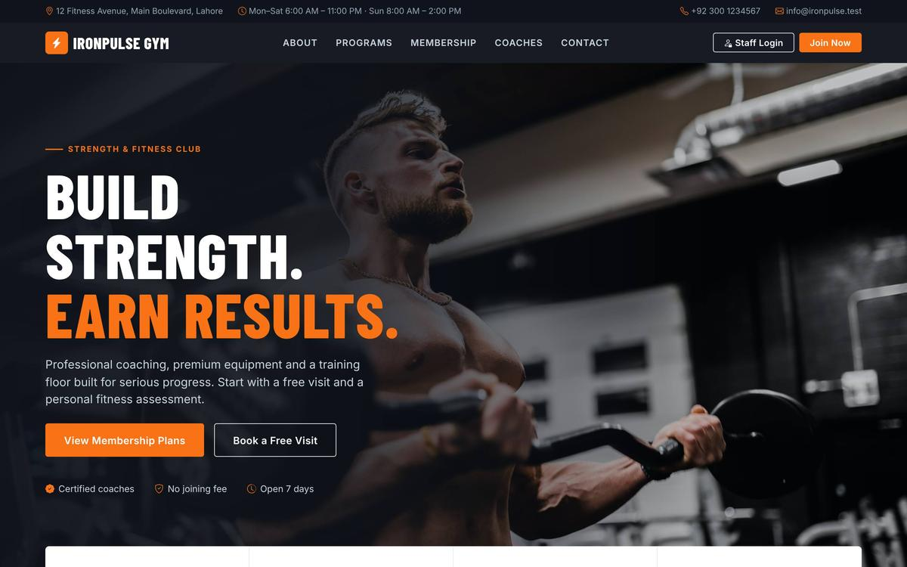
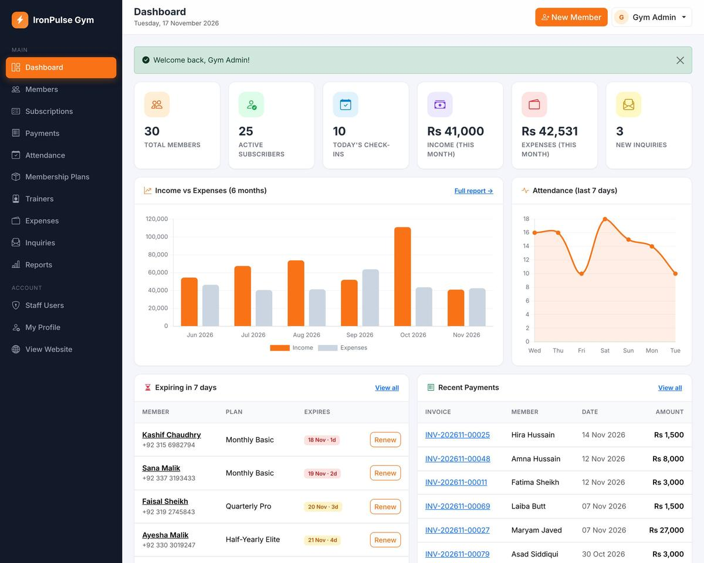
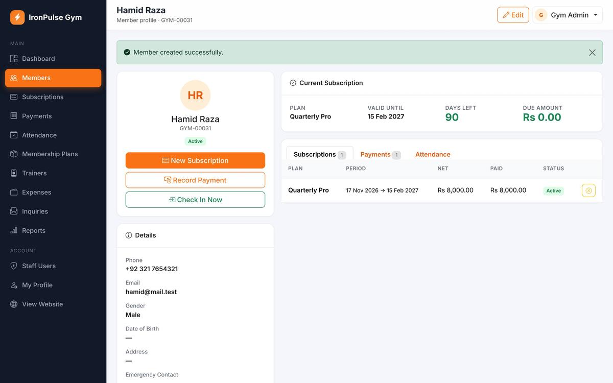
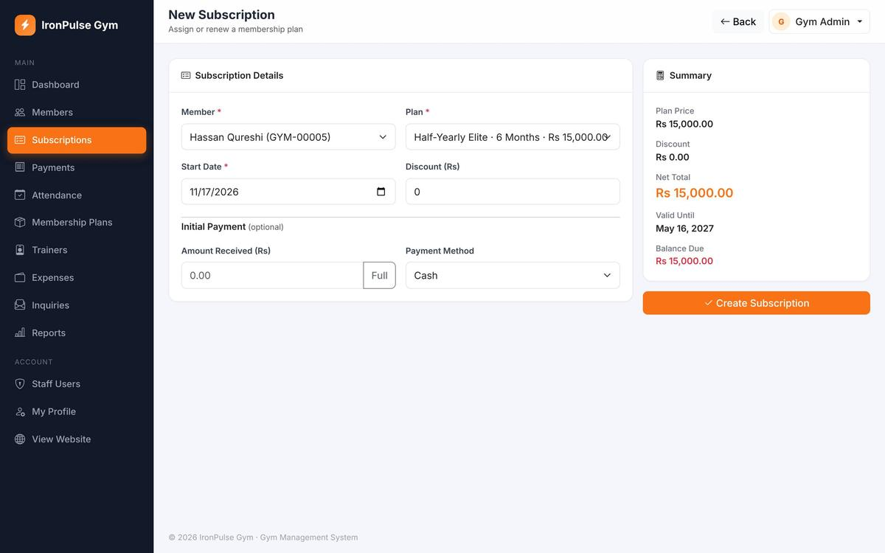
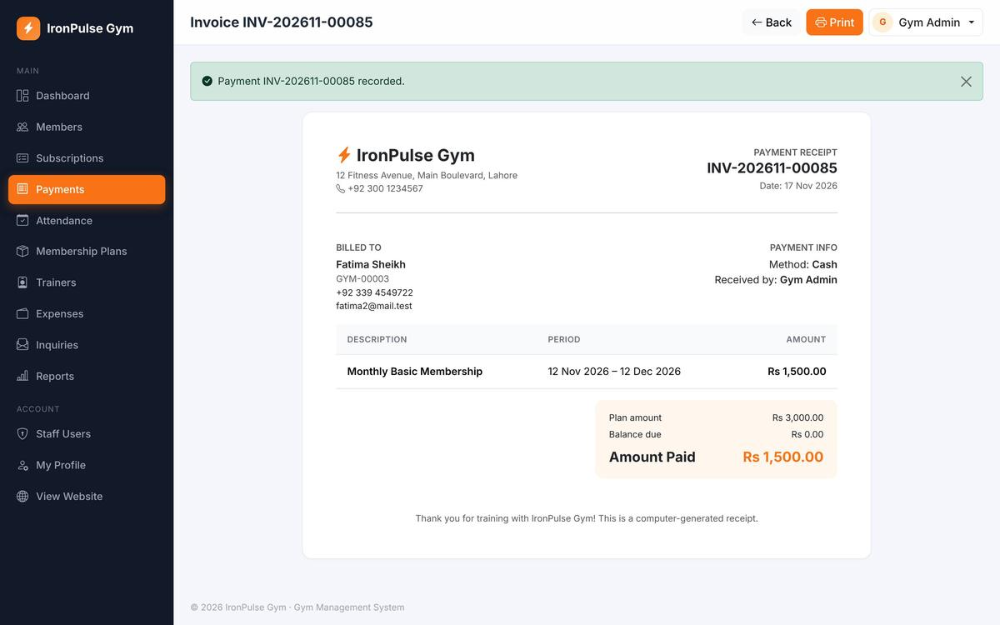
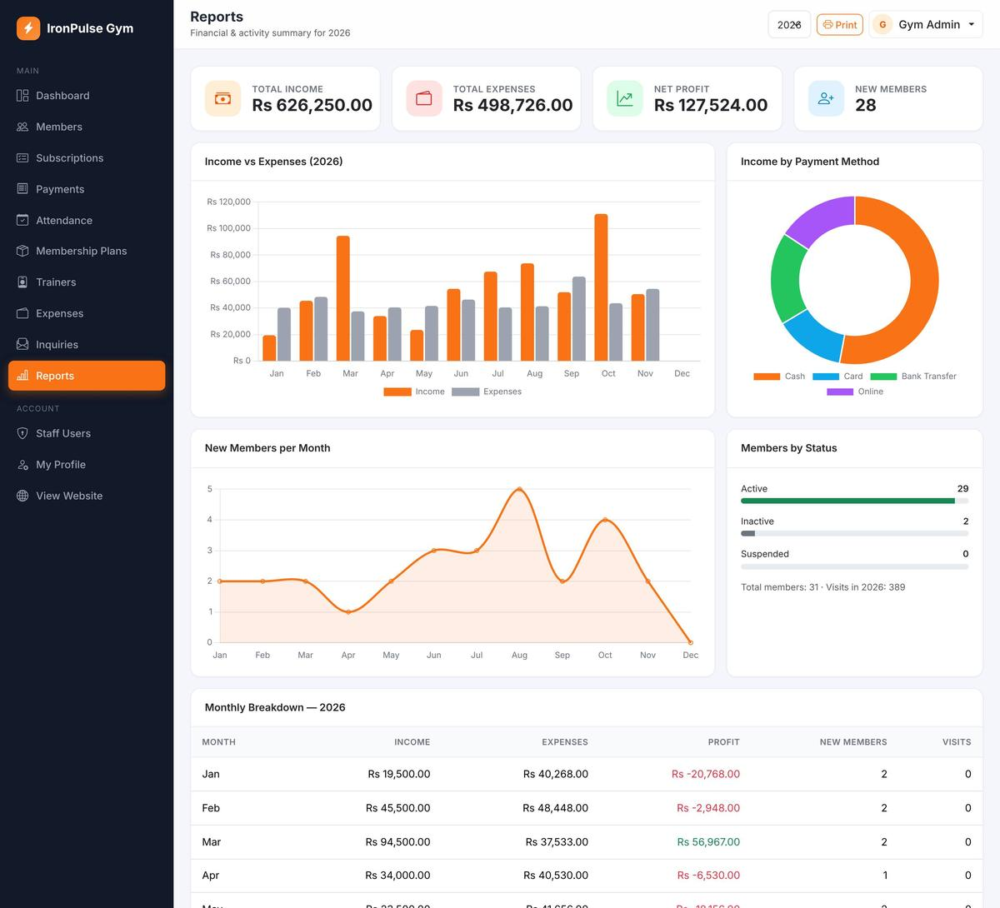
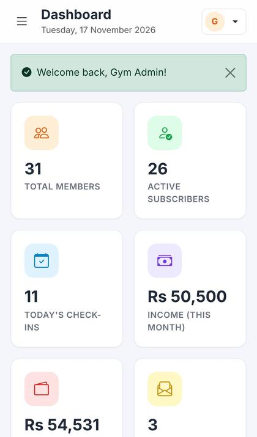
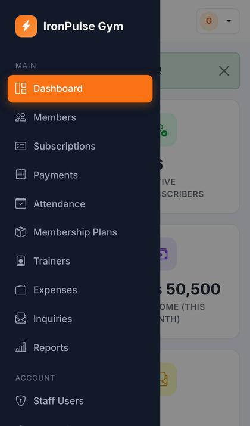
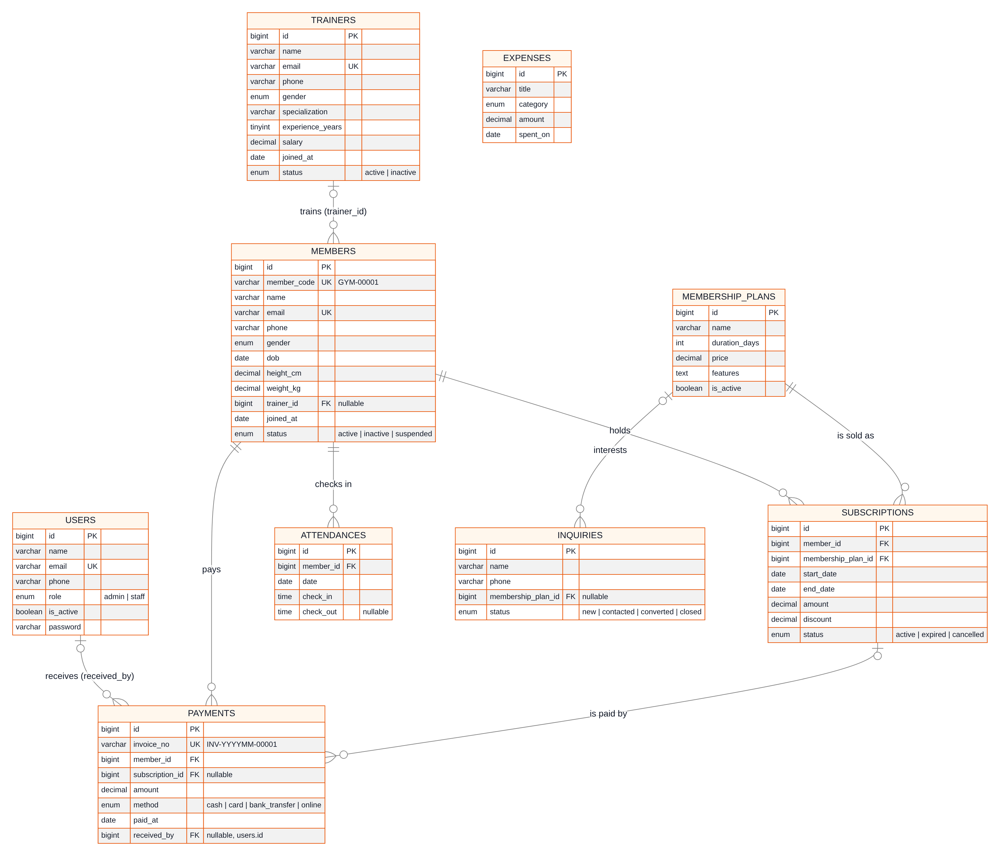

# IronPulse Gym — Gym Management System

A complete **gym management system** built with **Laravel 11, Blade and MySQL**. It has a public website for visitors and a login-protected admin panel for staff. It runs on ordinary **shared cPanel hosting**: no Redis, no queue workers and no Node build step.

Built as a semester project for **Database Management Systems (DBMS)**.



---

## Contents

- [Live demo](#live-demo)
- [Features](#features)
- [Screenshots](#screenshots)
- [Tech stack](#tech-stack)
- [Quick start](#quick-start)
- [Demo accounts](#demo-accounts)
- [Database](#database)
- [Deploying to shared cPanel hosting](#deploying-to-shared-cpanel-hosting)
- [Project structure](#project-structure)
- [Configuration](#configuration)
- [Documentation](#documentation)
- [Team](#team)

---

## Live demo

**https://gym.zapronixdigital.com**

The project is deployed on shared cPanel hosting (PHP 8.2, MariaDB, HTTPS). The public website is open to everyone. The admin login at `/login` uses private credentials that are **not** published here. To try the admin panel yourself, run it locally with the demo accounts below.

---

## Features

**Public website** (`/`)
- Landing page with programs, pricing, coaches, reviews and a contact form.
- Plans and coaches come live from the database.
- The contact form saves a lead in the admin panel under *Inquiries*.

**Admin panel** (`/admin`)

| Module | What it does |
|---|---|
| Dashboard | KPI cards, income vs expenses chart (6 months), 7-day attendance chart, subscriptions expiring within 7 days, recent payments |
| Members | Add, search and filter members. Auto member code (`GYM-00001`), BMI, assigned trainer, profile with subscription / payment / attendance history, optional plan and payment at registration |
| Subscriptions | Assign or renew a plan, end date calculated from the plan, discount, paid and due amounts, cancel, automatic expiry, "expiring soon" filter |
| Payments | Cash, card, bank transfer or online. Auto invoice number (`INV-YYYYMM-00001`), printable receipt, date and method filters |
| Attendance | One-click check-in and check-out, daily log, warning when a member has no active plan |
| Membership plans | Pricing cards with feature list. A plan that has been sold cannot be deleted, only deactivated |
| Trainers | Specialization, experience, salary and assigned members |
| Expenses | Categorised expenses with date filters and totals |
| Inquiries | Leads from the website, status workflow, "convert to member" |
| Reports | Yearly income, expenses, profit, new members and visits per month, with charts |
| Staff users | Admin-only. Two roles: `admin` and `staff` |
| My profile | Update your details and password |

The interface is responsive. On a phone the sidebar becomes a slide-in menu and tables scroll inside their cards.

---

## Screenshots

| Dashboard | Member profile |
|---|---|
|  |  |

| New subscription | Invoice |
|---|---|
|  |  |



**On a phone**

| Dashboard | Menu | Website |
|---|---|---|
|  |  |  |

---

## Tech stack

| Layer | Technology |
|---|---|
| Backend | PHP 8.2+, Laravel 11 (MVC), Eloquent ORM |
| Database | MySQL 5.7+ / MariaDB 10.3+, InnoDB, utf8mb4 |
| Frontend | Blade templates, Bootstrap 5.3, Bootstrap Icons, Chart.js 4 (all from a CDN) |
| Auth | Session login, bcrypt passwords, CSRF protection |
| Sessions / cache | File driver |
| Hosting target | Shared cPanel (Apache + PHP + MySQL) |

---

## Quick start

**Requirements:** PHP 8.2+ with the `pdo_mysql` extension, Composer, and MySQL or MariaDB.

```bash
git clone https://github.com/asjad2a9/dbms-uni-project.git
cd dbms-uni-project
composer install
cp .env.example .env
php artisan key:generate
```

Create an empty MySQL database (for example `gym_db`) and put its name and login in `.env` (`DB_DATABASE`, `DB_USERNAME`, `DB_PASSWORD`). Then run:

```bash
php artisan migrate --seed
php artisan serve
```

Open <http://127.0.0.1:8000> for the website and <http://127.0.0.1:8000/login> for the admin panel.

The seeder loads demo data: 4 plans, 5 trainers, 30 members with a year of subscriptions, payments and attendance, 12 months of expenses and 5 inquiries.

---

## Demo accounts

These accounts are created by `php artisan migrate --seed` on your own machine. The live site uses different passwords.

| Role | Email | Password |
|---|---|---|
| Admin | `admin@gym.test` | `password` |
| Staff | `staff@gym.test` | `password` |

Change these passwords (*My Profile*) before you put the site online.

---

## Database

9 tables and 8 foreign keys. The full diagram, key tables and relationship rules are in [`docs/ERD.md`](docs/ERD.md).



| Table | Purpose |
|---|---|
| `users` | Admin and staff accounts |
| `trainers` | Coaches |
| `members` | Gym members (unique `member_code`, optional `trainer_id`) |
| `membership_plans` | Plans for sale |
| `subscriptions` | Associative table: a member holds a plan for a period (this resolves the many-to-many between members and plans) |
| `payments` | Money received, with a unique `invoice_no` |
| `attendances` | One row per visit |
| `expenses` | Gym costs |
| `inquiries` | Leads from the website form |

**Relationships:** trainer 1 → N members · member 1 → N subscriptions / payments / attendances · plan 1 → N subscriptions · subscription 1 → N payments · user 1 → N payments · plan 1 → N inquiries.

**Delete rules:** `CASCADE` for a member's own records, `SET NULL` where history must survive, `RESTRICT` so a plan that has been sold cannot be deleted.

### Optional: views, stored procedures and triggers

[`docs/dbms_objects.sql`](docs/dbms_objects.sql) adds extra database objects for DBMS coursework:

- 5 views (active memberships, balance per subscription, monthly finance, trainer workload, daily attendance)
- 5 stored procedures, including a renewal that saves the subscription and payment in one transaction
- 3 triggers (payment must belong to the member, no double check-in, subscription audit log)
- 6 `CHECK` constraints, 2 indexes and one audit table

Run it once **after** `php artisan migrate --seed`. Use the phpMyAdmin *SQL* tab, or:

```bash
mysql -u USER -p DB_NAME < docs/dbms_objects.sql
```

The app works with or without it. [`docs/queries.sql`](docs/queries.sql) has 18 example queries (all join types, subqueries, aggregates, functions).

---

## Deploying to shared cPanel hosting

1. **Build locally.** Run `composer install --no-dev --optimize-autoloader`, then zip the whole project including `vendor/`.
2. **Upload** it with cPanel *File Manager* to a folder **outside** `public_html`, for example `/home/USER/gym`, and extract it.
3. **Point the web root at `public/`.** Pick one:
   - *Subdomain or addon domain:* set its document root to `/home/USER/gym/public`.
   - *Main domain:* copy the contents of `gym/public/` into `public_html/`, then edit `public_html/index.php` so the three paths point to the app folder:
     ```php
     require __DIR__.'/../gym/vendor/autoload.php';
     $app = require_once __DIR__.'/../gym/bootstrap/app.php';
     // and in the maintenance check:
     if (file_exists($maintenance = __DIR__.'/../gym/storage/framework/maintenance.php')) {
     ```
4. **Create the database** in cPanel → *MySQL® Databases*. Add a user and give it **ALL PRIVILEGES**.
5. **Create `.env`** from `.env.example` and set:
   ```env
   APP_ENV=production
   APP_DEBUG=false
   APP_URL=https://yourdomain.com
   DB_CONNECTION=mysql
   DB_HOST=localhost
   DB_DATABASE=cpaneluser_gym
   DB_USERNAME=cpaneluser_gymuser
   DB_PASSWORD=********
   SESSION_DRIVER=file
   CACHE_STORE=file
   QUEUE_CONNECTION=sync
   ```
6. **Run the migrations.**
   - *With Terminal or SSH:* `php artisan key:generate && php artisan migrate --seed --force && php artisan config:cache && php artisan route:cache && php artisan view:cache`
   - *Without SSH:* run the same commands locally against an empty MySQL database, export it from phpMyAdmin, and import it on the server. Generate `APP_KEY` locally and paste it into the server's `.env`.
7. **Permissions:** `storage/` and `bootstrap/cache/` must be writable (755 or 775).

No cron job is needed. Subscriptions are marked expired automatically whenever the dashboard or subscriptions page loads.

### Notes from a real deployment

These came up when the live demo was set up, and may save you time:

- **Set PHP 8.2 or newer** for the domain or subdomain (cPanel → *MultiPHP Manager*). Many hosts default to 8.1, and Laravel 11 will not run on it.
- **Keep the package small.** Build `vendor/` on your PC with `composer install --no-dev --optimize-autoloader --prefer-dist`. If it comes out huge, the libraries were fetched with git history. Remove it with `find vendor -name .git -prune -exec rm -rf {} +`. The final zip should be about 15–20 MB.
- **Do not overwrite cPanel's `.htaccess` block.** cPanel writes a "cPanel-generated handler" section into `public/.htaccess` for the PHP version. Keep it at the bottom and put Laravel's rewrite rules above it.
- **Keep `.env` outside the web root.** If the document root is the project's `public/` folder, `.env`, `vendor/` and `storage/` are not reachable from the web.
- **Use HTTPS.** If the browser reports an expired certificate on a new subdomain, check cPanel → *SSL/TLS Status* → *Manage AutoSSL* → *Excluded domains*. An older subdomain with the same name may still be excluded.
- **No SSH or terminal?** Run the migrations on your PC against an empty database, export it from phpMyAdmin and import it on the server (see step 6).

---

## Project structure

```
app/
  Http/Controllers/
    AuthController.php, SiteController.php      login, public website, join form
    Admin/                                      one controller per admin module
  Http/Middleware/EnsureAdmin.php               'admin' route middleware
  Models/                                       9 Eloquent models
bootstrap/app.php                               middleware aliases and redirects
config/gym.php                                  currency, address, phone, hours
database/
  migrations/                                   schema as code
  seeders/DatabaseSeeder.php                    demo data
docs/                                           ERD, SQL scripts, screenshots, project report
public/
  css/                                          admin.css, site.css (no build step)
  images/                                       website photos
resources/views/
  layouts/, partials/, auth/, site/, admin/<module>/
routes/web.php                                  all 60 routes
```

---

## Configuration

Set these in `.env`:

| Variable | Default | Meaning |
|---|---|---|
| `APP_NAME` | `IronPulse Gym` | Name shown in the site and admin panel |
| `GYM_CURRENCY` | `Rs` | Currency label |
| `GYM_ADDRESS`, `GYM_PHONE`, `GYM_EMAIL` | sample values | Shown on the website and on invoices |
| `GYM_HOURS` | sample hours | Shown on the website |

To change the brand colour, edit `--brand` in `public/css/admin.css` and `public/css/site.css`.

---

## Documentation

| File | Contents |
|---|---|
| [`docs/ERD.md`](docs/ERD.md) | ERD, relationship table, keys and indexes |
| [`docs/schema.sql`](docs/schema.sql) | Table definitions exported from MySQL |
| [`docs/queries.sql`](docs/queries.sql) | 18 example queries |
| [`docs/dbms_objects.sql`](docs/dbms_objects.sql) | Views, procedures, triggers, CHECK constraints |
| [`docs/IronPulse_Gym_DBMS_Project_Report.docx`](docs/IronPulse_Gym_DBMS_Project_Report.docx) | Project report (Word, 15 pages, includes the deployment section) |

---

## Team

Umais · Asjad · Ahmed

DBMS semester project, Ziauddin University.
