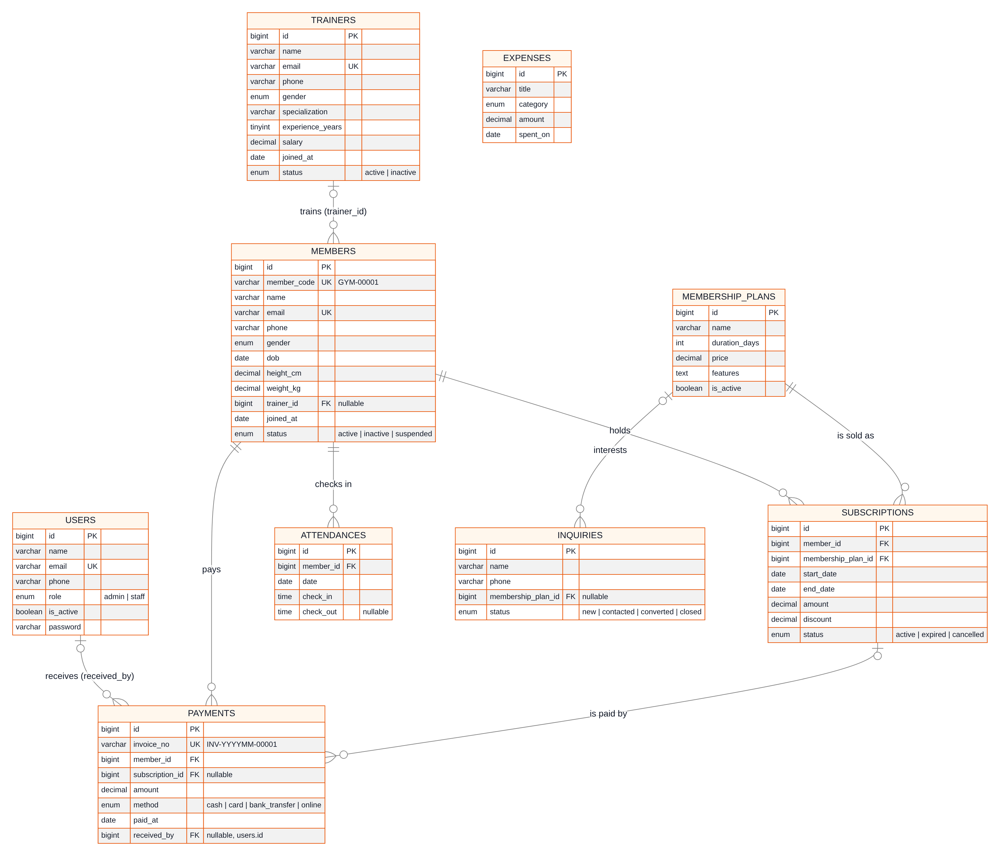
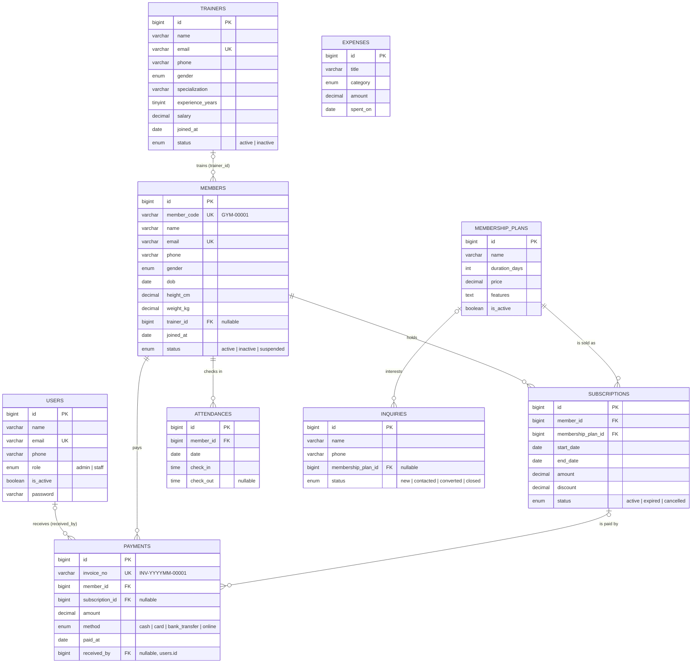

# Entity Relationship Diagram

The IronPulse Gym schema has **9 business tables** in MySQL (InnoDB, `utf8mb4_unicode_ci`), linked by **8 foreign keys**.

> The diagram source is below in Mermaid. GitHub renders it automatically. Vector version: [`erd.svg`](erd.svg).
> Full DDL: [`schema.sql`](schema.sql) · 18 example queries: [`queries.sql`](queries.sql) · Views, procedures, triggers: [`dbms_objects.sql`](dbms_objects.sql)

## Relationships

| # | Parent (PK) | Child (FK) | Cardinality | FK nullable | ON DELETE | Meaning |
|---|---|---|---|---|---|---|
| 1 | `trainers.id` | `members.trainer_id` | 1 : N (optional) | yes | SET NULL | A trainer coaches many members; a member has 0 or 1 trainer |
| 2 | `members.id` | `subscriptions.member_id` | 1 : N | no | CASCADE | A member holds many subscriptions over time |
| 3 | `membership_plans.id` | `subscriptions.membership_plan_id` | 1 : N | no | RESTRICT | A plan is sold many times; a plan in use can't be deleted |
| 4 | `members.id` | `payments.member_id` | 1 : N | no | CASCADE | A member makes many payments |
| 5 | `subscriptions.id` | `payments.subscription_id` | 1 : N (optional) | yes | SET NULL | A subscription can be paid in instalments |
| 6 | `users.id` | `payments.received_by` | 1 : N (optional) | yes | SET NULL | The staff user who collected the payment |
| 7 | `members.id` | `attendances.member_id` | 1 : N | no | CASCADE | One row per gym visit |
| 8 | `membership_plans.id` | `inquiries.membership_plan_id` | 1 : N (optional) | yes | SET NULL | The plan a website lead is interested in |

**Many-to-many:** `members` ⟷ `membership_plans` is **M : N**. It is resolved through **`subscriptions`**, an *associative entity* (a pivot table with its own attributes: `start_date`, `end_date`, `amount`, `discount`, `status`). There is no plain two-column pivot table, because each link carries its own data and its own payments.

**Standalone:** `expenses` has no foreign keys.

## Keys and indexes

| Table | Primary key | Unique keys | Other indexes |
|---|---|---|---|
| users | id | email | — |
| trainers | id | email | — |
| members | id | member_code, email | trainer_id (FK) |
| membership_plans | id | — | — |
| subscriptions | id | — | member_id, membership_plan_id (FKs), (status, end_date) |
| payments | id | invoice_no | member_id, subscription_id, received_by (FKs), paid_at |
| attendances | id | — | member_id (FK), (date, member_id) |
| expenses | id | — | spent_on |
| inquiries | id | — | membership_plan_id (FK) |

All primary keys are `BIGINT UNSIGNED AUTO_INCREMENT` surrogate keys. `member_code` (`GYM-00001`) and `invoice_no` (`INV-YYYYMM-00001`) are human-readable **candidate keys**, enforced with UNIQUE constraints.

## Mermaid source

